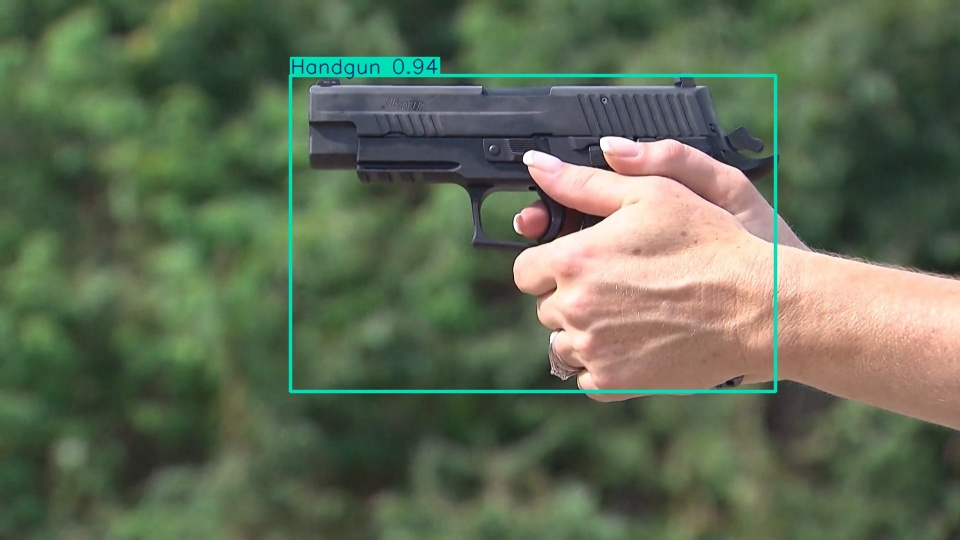
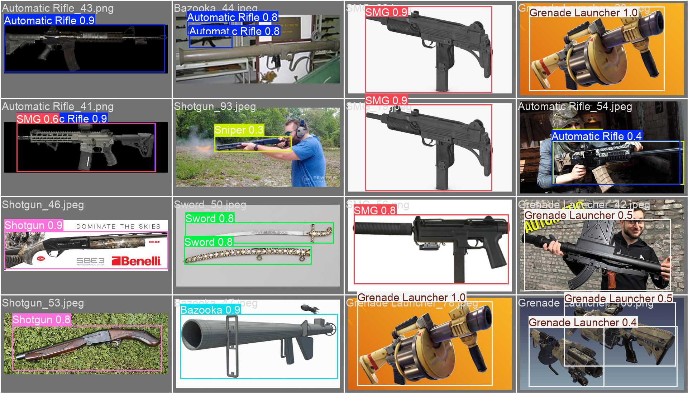
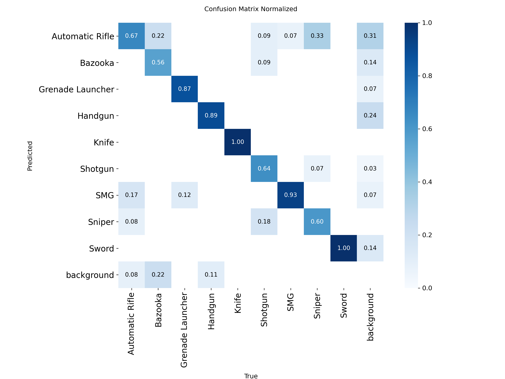
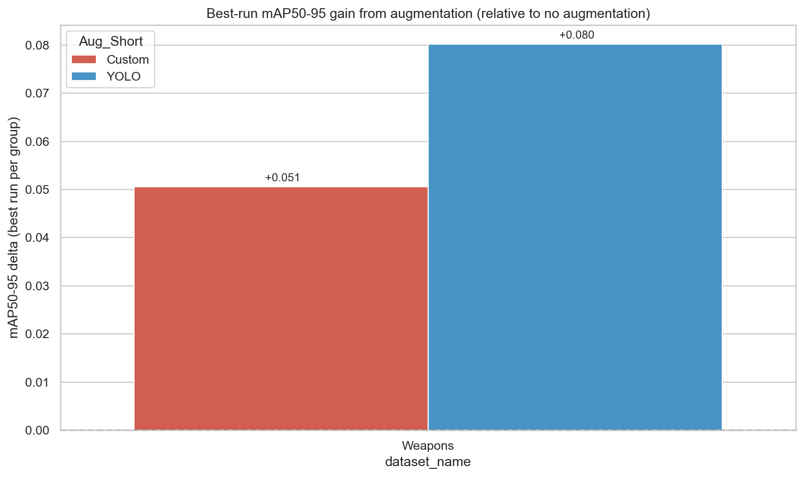

# Weapon Detection with YOLO11

Object detection of 9 weapon types in images, built with [Ultralytics YOLO11](https://docs.ultralytics.com/).
The project compares different training settings (model size, optimizer, learning rate, data augmentation),
trains the best configuration and evaluates it.

> This repository comes from a **two-person university project**. The weapon detection part (main part of this
> repo) is my work. The second part, face mask detection (`--task masks`), was done by my project partner and is
> kept here for completeness.



*Model output on one image from the cleaned validation set (`Handgun_13`, confidence 0.94).*

## Table of contents
- [Goal](#goal)
- [Dataset](#dataset)
- [Data problem I found](#data-problem-i-found)
- [Method](#method)
- [Results](#results)
- [Project structure](#project-structure)
- [How to run](#how-to-run)
- [Limitations](#limitations)
- [Credits](#credits)

## Goal
Detect and classify weapons in photos (draw a box around each weapon and name its class) and find out which
training settings work best on a small dataset.

Classes (9): Automatic Rifle, Bazooka, Grenade Launcher, Handgun, Knife, Shotgun, SMG, Sniper, Sword.

## Dataset
- **Weapons:** [Weapon Detection Dataset (Kaggle, snehilsanyal)](https://www.kaggle.com/datasets/snehilsanyal/weapon-detection-test)
  - 714 images with YOLO-format labels, license CC0.
  - Original split from Kaggle: 571 train / 143 val (the split is stored in `metadata.csv`, column `train_id`).
- **Masks (partner's part):** [Face Mask Dataset YOLO Format (Kaggle, aditya276)](https://www.kaggle.com/datasets/aditya276/face-mask-dataset-yolo-format)
  - 920 images, 2 classes (Mask, No Mask), split 700 train / 100 valid / 120 test.

The datasets are **not stored in this repository**. See [How to run](#how-to-run) for where to put them.

## Data problem I found
While checking the data I found **data leakage** in the original weapons split:
**77 of the 143 validation images are exact copies (same file bytes) of training images.**
A model evaluated on them has already seen those pictures, so the score is too high. The split comes from
Kaggle, I did not create it.

What I did:
- I wrote `src/check_dataset.py`, which finds near-duplicate images between splits (image hashing).
- I wrote `src/make_clean_val.py`, which copies the 66 validation images without a duplicate in train into a new
  folder `val_clean`. The original files are not changed.
- All weapon results below are measured on `val_clean`.

| Model | Original val (143 images, with leakage) | `val_clean` (66 images) |
|---|---|---|
| mAP@50 | 0.902 | **0.810** |
| mAP@50-95 | 0.770 | **0.683** |

(Same trained model, evaluated twice.) The first column is shown only to illustrate the effect of the leakage.

## Method
1. **Data check and preparation** (`prepare_data.py`, `check_dataset.py`, `make_clean_val.py`): find broken
   files and duplicates, plot class distribution, create an augmented copy of the training set with
   Albumentations (3 extra images per image).
2. **Grid search** (`grid_search.py`): 24 training runs, each with 100 epochs max and early stopping.
   - data variant: YOLO built-in augmentation / own Albumentations augmentation / no augmentation
   - model: `yolo11m` / `yolo11n`
   - optimizer: SGD / AdamW
   - initial learning rate: 0.01 / 0.001
3. **Analysis** (`analyze_results.py`): plots that compare the runs.
4. **Final training** (`train_final.py`): the best configuration (`yolo11m`, SGD, lr 0.001), up to 100 epochs with
   early stopping (patience 10), the same budget as in the grid search.
5. **Evaluation** (`evaluate.py`): metrics for each class.

## Results

### Final model (weapons)
Evaluated on `val_clean` (66 images, 117 objects). Model: `yolo11m`, trained for 48 epochs (early stopping), 9.9 min on one RTX 4070 SUPER.

| Metric | Value |
|---|---|
| mAP@50 | 0.810 |
| mAP@50-95 | 0.683 |
| Precision | 0.718 |
| Recall | 0.736 |

Per class (AP@50-95):

| Class | AP | Class | AP | Class | AP |
|---|---|---|---|---|---|
| Automatic Rifle | 0.506 | Handgun | 0.720 | Sniper | 0.723 |
| Bazooka | 0.473 | Knife | 0.837 | Sword | 0.858 |
| Grenade Launcher | 0.613 | Shotgun | 0.590 | SMG | 0.823 |

The weakest classes are Automatic Rifle and Bazooka; the best are Sword, Knife and SMG. Each class has only 6-9 validation images, so
these per-class numbers are uncertain.

| Predictions on validation images | Confusion matrix |
|---|---|
|  |  |

### Comparison of training settings
24 training runs on `val_clean` (results in `results/weapons_grid.csv`). Best run for each data variant:

| Data variant | Best mAP@50-95 | Best mAP@50 |
|---|---|---|
| YOLO built-in augmentation | **0.683** | 0.810 |
| Own augmentation (Albumentations) | 0.653 | 0.797 |
| No augmentation | 0.602 | 0.718 |

Other observations from the grid:
- Best setup: `yolo11m` + SGD + lr 0.001 (mAP@50-95 0.683). Best `yolo11n` run: 0.626.
- SGD with lr 0.001 was the most stable (mean 0.601). AdamW with lr 0.01 often failed to train (mean 0.180).
- Both kinds of augmentation beat no augmentation; the built-in YOLO augmentation was better than my own pipeline
  in this setup.



> Note: every setting was trained once (one random seed), so small differences may be noise.

## Project structure
```
.
├── src/            scripts (run from anywhere, they use paths relative to the repo)
├── configs/        YOLO dataset configs: weapons/ and masks/ (data.yaml, data_raw.yaml, data_aug.yaml)
├── metadata/       weapons_metadata.csv from Kaggle (original train/val assignment)
├── results/        grid-search results (CSV) and plots
├── runs/           final training runs: curves, confusion matrix, example predictions
└── data/           datasets - NOT in git, download from Kaggle (see below)
```

| Script | What it does |
|---|---|
| `src/check_dataset.py` | split sizes, class check, duplicates between splits |
| `src/make_clean_val.py` | builds `val_clean` (weapons) |
| `src/prepare_data.py` | validates files, plots class counts, creates augmented training set |
| `src/grid_search.py` | grid search, writes `results/<task>_grid.csv` |
| `src/analyze_results.py` | plots from the grid-search results |
| `src/train_final.py` | trains the final model |
| `src/evaluate.py` | evaluates saved weights, prints per-class AP |
| `src/fix_labels.py` | corrects class ids in labels using the Kaggle `metadata.csv` |

## How to run
Tested with Python 3.12 and Ultralytics 8.3.208.

```bash
# 1. install
python -m venv .venv
.venv\Scripts\activate          # Windows
pip install -r requirements.txt  # for GPU training install a CUDA build of PyTorch first

# 2. download the dataset from Kaggle and unpack it as (pretrained YOLO weights are downloaded automatically)
#    data/weapons/train/{images,labels} and data/weapons/val/{images,labels}

# 3. prepare data
python src/check_dataset.py
python src/make_clean_val.py
python src/prepare_data.py

# 4. experiments (a few hours on one GPU) and plots
python src/grid_search.py
python src/analyze_results.py

# 5. final model and evaluation
python src/train_final.py
python src/evaluate.py --split val
```
All scripts default to `--task weapons`. Use `--task masks` for the mask detection part
(masks data goes to `data/masks/{images,labels}/{train,valid,test}`).
`grid_search.py` appends to `results/<task>_grid.csv`, so move the old file away before running it again.

## Limitations
- The weapons dataset is small (714 images). After cleaning, the validation set has only 66 images.
- There is no separate test set for weapons, so results come from the validation set.
- Every configuration in the grid search was trained once, without repeated seeds.
- Runs with the built-in YOLO augmentation trained longer before early stopping (on average 57 epochs, versus 39
  without augmentation and 26 with my own augmentation). Training length and augmentation are therefore mixed together.
- The best configuration was chosen on the same validation set that is used to report the final result, so the result is
  slightly optimistic.
- The duplicate detection finds copies and resized copies. It may miss heavily edited or cropped versions.
- The model was trained on web images; it is a study project and not a ready-to-use security system.

## Credits
- Weapons detection part, data checks and this repository structure: Sebastian.
- Face mask detection part: my project partner.
- Datasets: snehilsanyal (weapons) and aditya276 (masks) on Kaggle. Model: Ultralytics YOLO11.
